# GardenProof

**Turn every finished garden job into proof that wins the next high-ticket client.**

GardenProof is a content engine for UK landscapers. Crews capture before/after photos over WhatsApp in under a
minute. The homeowner rates the job and gives consent from a link. The system then drafts a portfolio page, local SEO
content, Meta and Google ad copy, before/after videos, social posts and a Google Business Profile post. The agency
reviews everything before anything goes public, and a lead log shows which content brought in new enquiries.

Pilot client: **Thorburn Landscapes** (SW London). This repository is **Phase 1**: content, testimonials and new-client
acquisition. The CRM and maintenance renewals come in Phase 4 (see the PRD).

---

## Try it in 2 minutes (no keys needed)

```bash
pnpm install
pnpm seed        # demo tenant, crew, customers and 3 jobs using real Thorburn photos
pnpm dev         # http://localhost:3000
```

| Open | What you'll see |
|---|---|
| `/simulator` | A WhatsApp simulator. Be **Marco (foreman)**: send a before photo, tap through, send an after photo, tap Done. About 6 taps. |
| `/` | Agency dashboard: pipeline, "needs you", background work |
| `/jobs/job_patio` | Job detail: photos (privacy status), story, testimonial and consents, generated assets with checks |
| `/review` | Review queue (`j`/`k` to move, `a` approve, `r` reject) |
| `/messages` | Safe-mode outbox: homeowner messages wait for your approval |
| `/r/<token>` | The homeowner's review and consent page (link appears in the simulator after you approve the message) |
| `/preview/<assetId>` | The portfolio case-study page as it will look on the website |
| `/portfolio` | Portfolio grid (the future embeddable widget) |
| `/leads` | Lead log with first- and last-touch attribution per asset |

In demo mode, AI copy comes from a deterministic mock (labelled "Demo AI"), messages go to the simulator, and
publishing writes local previews instead of WordPress. With `pnpm build && DEMO_MODE=on pnpm start` the production build
also runs locally; without `DEMO_MODE=on` it refuses to start unless `ADMIN_PASSWORD` is set.

## How it works

```mermaid
flowchart LR
  A[Crew on WhatsApp<br/>before / after / voice note] --> B[Capture bot<br/>tap-only state machine]
  B --> C[(Postgres + task queue)]
  C --> D[Enrich<br/>AI tags + privacy screen]
  D --> E[Homeowner link<br/>rating, quote, 4 consents]
  E --> F[Content engine<br/>page, ads, social, GBP, SEO]
  F --> G[Remotion videos<br/>3 templates x 3 ratios]
  F --> H[Agency review<br/>checks, edit, approve]
  G --> H
  H --> I[Publish<br/>WordPress, ad bundles, exports]
  I --> J[Lead log<br/>gp-track.js + /api/leads]
```



Nothing slow runs inside a web request. Webhooks, forms and dashboard buttons add rows to a **durable task queue**
(`tasks` table), and a worker runs them with retries: in the same process by default, or `pnpm worker` on its own.

| Module | Where | What |
|---|---|---|
| Capture bot and messaging | `src/lib/bot`, `src/lib/messaging`, `src/app/api/whatsapp`, `src/app/simulator` | Pure state machine (tested tap counts), Twilio provider, safe mode, opt-out, idempotent webhook |
| Testimonials and consent | `src/lib/testimonials`, `src/lib/customers.ts`, `src/app/r` | Homeowner page, 4 granular consents with stored wording, withdrawal, 48 h expiry |
| Content engine | `src/lib/ai`, `src/lib/content`, `prompts/`, `evals/` | Claude with zod-validated structured output, deterministic mock, lint checks, golden-set evals |
| Video | `video/`, `src/lib/video` | Remotion compositions in Thorburn's house style, consent-aware props, local media server |
| Publishing and website | `src/lib/publish`, `src/components/portfolio`, `wordpress/`, `public/gp-track.js` | Portfolio page design, JSON-LD, WordPress plugin + REST publisher, ad bundle CSVs, lead tracking |
| Dashboard | `src/app/(dashboard)`, `src/lib/dashboard`, `src/proxy.ts` | Review, edit, approve, privacy clearance, withdrawal, background work, leads, auth |
| Queue | `src/lib/tasks`, `src/instrumentation.ts`, `scripts/worker.ts` | `SKIP LOCKED` claims, dedupe, backoff, stale-lock recovery |
| Shared contracts | `src/lib/domain.ts`, `src/db/schema.ts`, `src/lib/privacy.ts`, `src/lib/tenant.ts` | Asset schemas, DB, the single "may this image be public?" rule, tenant config |

## Safety guarantees (enforced in code and covered by tests)

- **Real work only.** AI writes words; code inserts facts, media ids and the verbatim quote. Lint blocks invented numbers, ratings and claims.
- **Consent first.** Photos, quote (and rating), area and first name are four separate permissions. Nothing appears without its permission. Withdrawal unpublishes everything.
- **Photo privacy.** Originals (with GPS) are stored under `private/` and never served publicly. Only EXIF-stripped copies are public. Photos flagged for faces, number plates or house numbers are withheld until they are blurred or an operator clears them.
- **Safe mode (default on).** Homeowner messages wait for agency approval. Double approval sends once. Opt-out is honoured.
- **Nothing public without review.** Approval is refused while consent or privacy checks fail. Drafts are only visible to operators.

## Commands

| Command | Does |
|---|---|
| `pnpm dev` / `pnpm build` / `pnpm start` | Next.js 16 |
| `pnpm seed` | Reset the demo tenant (refuses in production) |
| `pnpm worker` | Standalone background worker |
| `pnpm db:migrate` / `pnpm db:generate` | Drizzle migrations |
| `pnpm test` | Vitest (514 tests, in-memory Postgres) |
| `pnpm typecheck` / `pnpm lint` | TypeScript strict / ESLint |
| `pnpm eval` | Content evals on the golden set, writes `evals/report.md` |
| `pnpm content:demo` | Generate content for the seeded jobs |
| `pnpm video:samples` / `pnpm video:studio` | Render sample videos / open Remotion Studio |
| `pnpm plugin:zip` | Build the WordPress plugin zip |

## Going live

See **[docs/DEPLOY.md](docs/DEPLOY.md)**: container host (Railway, Fly or Render) + Supabase Postgres and Storage +
Twilio WhatsApp (sender and approved template) + the WordPress plugin. It includes the full list of environment variables.

## Reviewing this build

See **[REVIEW.md](REVIEW.md)**: what to look at, screenshots of the whole journey, sample videos, QA and code-review
reports, and the list of known gaps.
